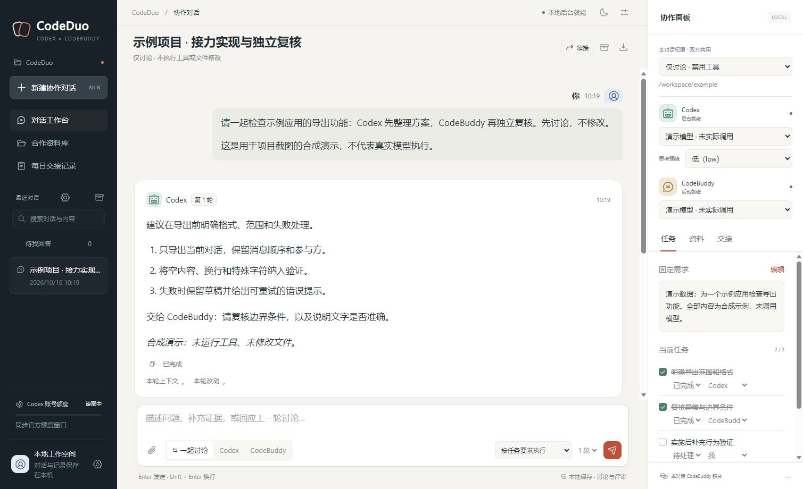

# CodeDuo

**Codex × CodeBuddy 联合协作台**

让 Codex 推进任务，让 CodeBuddy 独立复核，再把修正结果交回同一条对话。

[English](README.en.md) · [安装与配置](docs/SETUP.md) · [隐私与安全](docs/PRIVACY.md) · [参与贡献](CONTRIBUTING.md)

[](https://github.com/fhw0830/codex-codebuddy-workbench/actions/workflows/ci.yml)

CodeDuo 是运行在你自己电脑上的网页工作台。它连接本机的 Codex CLI 和 CodeBuddy Code CLI，把任务说明、执行过程、定向交接、人工问答和代码差异放在一个界面中。适合需要“一个推进、另一个复核”的个人开发流程。

这是独立社区项目，与 OpenAI、腾讯不存在官方隶属或背书关系。工具账号、模型服务和费用由各自提供方管理；本项目的 MIT 许可证不包含模型服务或第三方 CLI 的授权。



## 怎样联合工作

```text
你：给出目标、资料和本轮权限
              ↓
Codex：调查 / 实施 / 验证 → 交接具体证据
              ↓
CodeBuddy：独立复核 → 提出问题或报告检查结果
              ↓
下一轮 Codex 修正 → CodeBuddy 复验
              ↓
你：查看结果，回答必要问题，决定下一步
```

“一轮”包含双方各一次回复。可选择单方处理，也可选择最多三轮接力。首轮讨论、下一轮执行的方式需要与当前权限配合；选择轮数不会自动授权额外操作。

## 已有功能

- **同一任务接力**：保留固定需求、任务台账、双方上下文；支持定向复核和失败后的续接。
- **看得见的执行过程**：流式回复、工具事件、计划进度、实际代码差异与行内反馈草稿。
- **中途问答**：选项与自由输入、待回答筛选、同对话消息排队，以及有回执的中途补充。
- **独立对话**：各自保存模型、工作目录和权限；对同一项目或设备的写入进行进程内资源协调。
- **本地资料**：用户选择文件、拖放附件、引用文本片段，支持 Markdown / JSON 导出和每日记录。
- **长对话管理**：任务边界摘要、原文归档、上下文范围检查、存储回收与恢复。
- **用量可见**：展示工具实际报告的 Tokens、Codex 额度及 CodeBuddy credit；缺失值不会当成零。
- **轻量界面**：明暗主题、窄屏布局、本地前端资源、中文输入法与阅读位置保持。

模型列表来自本机工具及账号；列表出现某个模型不保证当前账号能完成该模型的请求。显示的数据只代表工具报告的范围。

## 快速开始

当前主要面向 **Windows 10/11**，需要 **Python 3.12+**、Node.js，以及你自己安装并登录的两款 CLI。其他平台的直接 Python 启动入口可用，但尚未做完整平台验收。

```powershell
git clone https://github.com/fhw0830/codex-codebuddy-workbench.git
cd codex-codebuddy-workbench

# 按官方指南安装 Codex CLI，并完成自己的登录
npm install -g @openai/codex
codex login

# 下载本工作台适配的固定 CodeBuddy CLI 版本到用户缓存
python scripts/prepare_runtime.py

# 打开这个命令输出的 CodeBuddy 入口，按其提示完成自己的登录
# 默认 Windows 入口：%LOCALAPPDATA%\CodeDuo\runtime\codebuddy\2.164.0\bin\codebuddy
# 示例：node "$env:LOCALAPPDATA\CodeDuo\runtime\codebuddy\2.164.0\bin\codebuddy"

python server.py --open
```

也可以双击 `Start-CodeDuo.cmd`。如果本机 `python` 不在 PATH，请先安装 Python，或设置 `CODEDUO_PYTHON` 指向 Python 可执行文件。启动脚本不会设置开机自启，也不会代替你登录。

默认地址是 `http://127.0.0.1:8766`；端口被占用时会尝试后续九个端口。实际地址写在 `data/server.json`。首次启动后在右侧确认双方连接状态、模型、权限和工作目录，再发送任务。

只想先看界面，不启动任何模型工具：

```powershell
python server.py --offline --open
```

离线预览不是模型功能验收。截图中的内容为合成演示，不包含真实会话。

## 权限和数据

新安装默认 **仅讨论**：不提供文件、命令或 SSH 工具。你可以在对话中主动切换到完全访问；此时模型能调用本机文件、命令和已有连接，实际范围由你的任务授权决定。

服务只监听回环地址，具有来源检查及写请求校验；它没有多用户登录体系。请作为个人本地工具使用，不要通过公网或共享代理暴露服务。资源协调是应用内的并发管理，不提供操作系统级隔离。

对话、上传、日志及摘要保存在 `data/`，每日记录默认为 `data/archive/`，工作目录默认为 `data/agent-workspace/`。这些内容被 Git 忽略。**本地保存不等于模型请求离线**：发送给模型的提示词、历史及所选附件会经 CLI 交给相应服务商处理。

发布源码采用全新历史，不带原项目的数据库、聊天记录、上传、日志、内部文档、个人路径或账号配置。后续提交仍应自行检查；内置扫描只是辅助。

## 开发与检查

核心文本对话后端使用 Python 标准库；图片验证和部分文档提取使用可选依赖。前端为原生 HTML / CSS / JavaScript，已随仓库附带必要浏览器资源。不需要 `npm install` 就能运行网页。完整测试须先安装测试依赖：

```powershell
python -m pip install -r requirements-dev.txt
python -m unittest discover -s tests -p "test_*.py"
python scripts/run_js_tests.py
python scripts/privacy_check.py
```

默认测试使用临时目录和模拟适配器，不会调用真实模型或操作外部设备。可选文档提取依赖及运行时配置见[安装说明](docs/SETUP.md)。架构见[开发说明](docs/ARCHITECTURE.md)。

## 当前限制

- 这是网页自己的对话，不会同步到 Codex / CodeBuddy 桌面应用的聊天记录。
- 双方接力有明确先后；双方的推理不是同一轮并行执行。
- 首发验证覆盖离线测试与本地页面；未为每个账号、模型和 CLI 版本进行真实付费推理验收。
- CLI 协议可能变化。CodeBuddy 固定为 `2.164.0`；Codex 来源于用户本机安装，升级后请先检查连接。
- 取消或重试不能撤销已经发生的文件修改；重试前要核对外部副作用。

## 许可证与致谢

原创代码采用 [MIT](LICENSE)。浏览器附带的 markdown-it 与 Phosphor 图标保留各自许可证，见 [THIRD_PARTY_NOTICES.md](THIRD_PARTY_NOTICES.md)。感谢两款工具提供本地 CLI 集成入口。

官方参考：[Codex CLI](https://learn.chatgpt.com/docs/codex/cli)、[Codex App Server](https://learn.chatgpt.com/docs/app-server)、[CodeBuddy Code 快速入门](https://www.codebuddy.cn/docs/cli/quickstart)。
